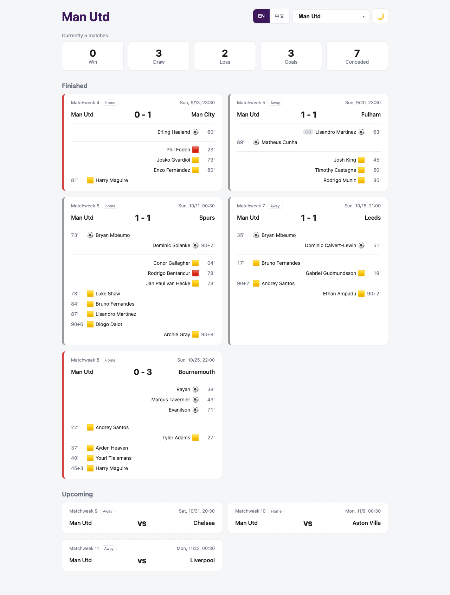

# Premier-League-Dashboard

**English** | [繁體中文](README.zh-TW.md)

A Premier League dashboard for the 2026/27 season. Pick any of the 20 clubs to see its last 5 finished matches and next 3 upcoming ones.

This is a learning project: the backend is a FastAPI server that fetches live data from the Premier League's Pulse API, and the frontend is a React dashboard.



## Features

- **Team selector**: switch between all 20 Premier League clubs (default: Man Utd)
- **English / Traditional Chinese**: `/` is the English page, `/zh` is the Traditional Chinese page, with an EN | 中文 switch in the header. Labels, dates and club names are translated (player names stay in English)
- **Form summary**: wins / draws / losses, goals for and against over the last 5 matches
- **Finished matches**: score, goals (time, scorer, own goal / penalty), yellow and red cards
- **Upcoming matches**: opponent and kickoff time for the next 3 matches
- Kickoff times are shown in Taiwan time (UTC+8)
- The selected team is always shown on the left, with a Home / Away label
- Goals and cards line up under each team: the selected team's events on the left, the opponent's on the right, with OG / P tags for own goals and penalties
- Each card has a coloured left border for win (green) / draw (grey) / loss (red)
- **Light / dark theme toggle**: follows the system setting on first visit, and remembers your choice
- Responsive layout: two columns of match cards on wide screens, one column on mobile
- Loading and error states
- Data is fetched live on every request, so it is always up to date

## Tech Stack

| Part | Uses |
|---|---|
| Backend | Python 3 + FastAPI |
| Data source | Premier League Pulse API (`footballapi.pulselive.com`) |
| Frontend | React 19 + Vite + React Router |

## Project Structure

```
Eurpoe-football/
├── backend/
│   ├── main.py                  # FastAPI app: /api/teams, /api/matches
│   └── premier_league.py        # Fetches the Pulse API and builds the match summary
└── frontend/
    └── src/
        ├── main.jsx             # Entry point, wraps the app in BrowserRouter
        ├── App.jsx              # Routes: / (English), /zh (Chinese), 404
        ├── PremierLeague.jsx    # Main page: team selector, fetches data, splits finished / upcoming
        ├── Summary.jsx          # Form summary
        ├── MatchCard.jsx        # Single match card
        ├── ThemeToggle.jsx      # Light / dark theme button
        ├── LanguageSwitch.jsx   # EN | 中文 links
        ├── i18n.js              # Translation dictionary, club names, LanguageContext and useLang()
        ├── matchUtils.js        # Shared helpers: home/away side, match result, time formatting
        └── index.css
```

## Data Flow

```
Pulse API ──> backend (FastAPI, :8000) ──> frontend (React, :5173)
```

When you pick a team, React calls `/api/matches?team=...`. The backend then fetches that team's fixtures and match details from the Pulse API and returns a JSON summary.

## Getting Started

Requires **Python 3** and **Node.js 18+**. You need two terminals: one for the backend, one for the frontend.

**1. Start the backend**

```bash
pip3 install "fastapi[standard]"
cd backend
fastapi dev main.py
```

The API runs at http://localhost:8000. Run it from inside `backend/` so `main.py` can import `premier_league.py`.

**2. Start the frontend**

```bash
cd frontend
npm install
npm run dev
```

Open the URL shown in the terminal (usually http://localhost:5173 ). The Traditional Chinese page is at http://localhost:5173/zh .

## API

| Endpoint | Description |
|---|---|
| `GET /api/teams` | List of all 20 club names, sorted alphabetically |
| `GET /api/matches?team=Arsenal` | Last 5 finished + next 3 upcoming matches for that team. `team` defaults to `Man Utd`. Returns 404 if the team is not found |

Interactive API docs are available at http://localhost:8000/docs .

### Match format

```json
{
  "gameweek": 4,
  "kickoff": "Sun 13 Sep 2026, 16:30 BST",
  "kickoff_ms": 1789313400000,
  "status": "C",
  "home": { "team": "Man Utd", "score": 0 },
  "away": { "team": "Man City", "score": 1 },
  "goals": [{ "time": "60'00", "team": "Man City", "player": "Erling Haaland", "type": "G" }],
  "cards": [{ "time": "81'00", "team": "Man Utd", "player": "Harry Maguire", "card": "Y" }]
}
```

- `kickoff` is the UK-time label from Pulse; `kickoff_ms` is a Unix timestamp in milliseconds, which the frontend converts to Taiwan time in the current language
- `status`: `C` completed, `U` upcoming. `score` is `null` for upcoming matches
- `goals.type`: `G` goal, `O` own goal, `P` penalty
- `cards.card`: `Y` yellow, `R` red, `YR` second yellow (red)

## Roadmap

- [x] Switch the backend to FastAPI and have the frontend call the API
- [x] Team selector, not just Man Utd
- [x] Improve the layout and styling
- [x] Light / dark theme toggle
- [x] Traditional Chinese page

## Notes

The Pulse API is the undocumented API used by the official Premier League website. Its format may change at any time. This project is for learning purposes only.
