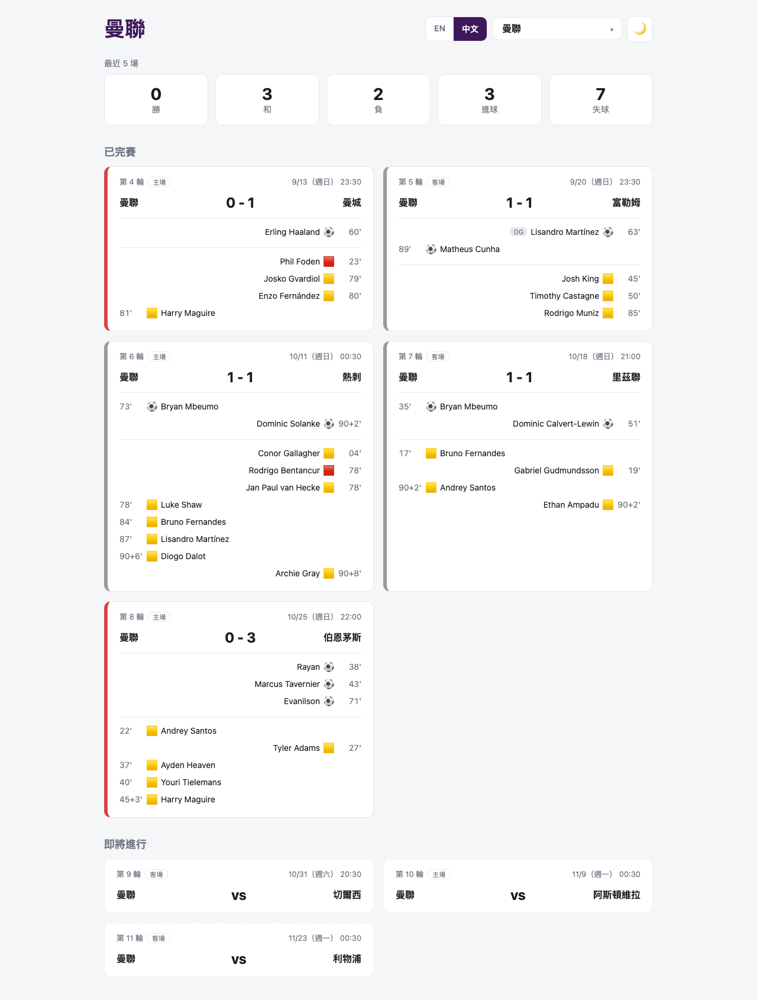

# Premier-League-Dashboard

[English](README.md) | **繁體中文**

2026/27 賽季英超儀表板。可以選擇 20 支英超球隊中的任何一隊，查看最近 5 場已完賽和接下來 3 場比賽。

這是一個學習用的專案：後端是 FastAPI 伺服器，從英超官網的 Pulse API 抓即時資料；前端用 React 做成 dashboard。



## 功能

- **選擇球隊**：可以切換 20 支英超球隊（預設是 Man Utd）
- **英文 / 繁體中文**：`/` 是英文版、`/zh` 是繁體中文版，標題列有 EN | 中文 切換。介面文字、日期和球隊名稱都會翻譯（球員名字維持英文）
- **戰績總覽**：最近 5 場的勝 / 和 / 負、進球、失球
- **已完賽**：比分、進球（時間、球員、烏龍球 / 點球）、紅黃牌
- **即將進行**：接下來 3 場的對手和開賽時間
- 開賽時間以台灣時間（UTC+8）顯示
- 選擇的球隊固定顯示在左邊，並標示 Home / Away
- 進球和紅黃牌對齊各自的球隊：選擇的球隊靠左、對手靠右，烏龍球和點球有 OG / P 標籤
- 卡片左側依勝（綠）/ 和（灰）/ 負（紅）上色
- **淺色 / 深色主題切換**：第一次打開時跟著系統設定，之後會記住你的選擇
- 響應式排版：寬螢幕時卡片排成兩欄，手機上自動變成一欄
- 載入中與讀取失敗的提示畫面
- 每次請求都即時抓資料，資料永遠是最新的

## 技術

| 部分 | 使用 |
|---|---|
| 後端 | Python 3 + FastAPI |
| 資料來源 | Premier League Pulse API（`footballapi.pulselive.com`） |
| 前端 | React 19 + Vite + React Router |

## 專案結構

```
Eurpoe-football/
├── backend/
│   ├── main.py                  # FastAPI：/api/teams、/api/matches
│   └── premier_league.py        # 抓 Pulse API，整理成比賽摘要
└── frontend/
    └── src/
        ├── main.jsx             # 進入點，用 BrowserRouter 包住整個 App
        ├── App.jsx              # 路由：/（英文）、/zh（中文）、404
        ├── PremierLeague.jsx    # 主頁面：選擇球隊、fetch 資料、分成已完賽 / 即將進行
        ├── Summary.jsx          # 戰績總覽
        ├── MatchCard.jsx        # 單場比賽卡片
        ├── ThemeToggle.jsx      # 淺色 / 深色主題按鈕
        ├── LanguageSwitch.jsx   # EN | 中文 切換連結
        ├── i18n.js              # 翻譯字典、球隊中文名、LanguageContext 和 useLang()
        ├── matchUtils.js        # 共用函式：判斷主客場、勝負、時間格式
        └── index.css
```

## 資料流程

```
Pulse API ──> 後端（FastAPI，:8000）──> 前端（React，:5173）
```

選擇球隊後，React 會呼叫 `/api/matches?team=...`，後端再去 Pulse API 抓這支球隊的賽程和比賽細節，整理成 JSON 回傳。

## 如何執行

需要 **Python 3** 和 **Node.js 18 以上**。要開兩個終端機，一個跑後端、一個跑前端。

**1. 啟動後端**

```bash
pip3 install "fastapi[standard]"
cd backend
fastapi dev main.py
```

API 會在 http://localhost:8000 執行。要在 `backend/` 裡面執行，`main.py` 才 import 得到 `premier_league.py`。

**2. 啟動前端**

```bash
cd frontend
npm install
npm run dev
```

打開終端機顯示的網址（通常是 http://localhost:5173 ）。繁體中文版在 http://localhost:5173/zh 。

## API

| 網址 | 說明 |
|---|---|
| `GET /api/teams` | 20 支球隊的名稱，依字母排序 |
| `GET /api/matches?team=Arsenal` | 該球隊最近 5 場已完賽 + 接下來 3 場。`team` 預設是 `Man Utd`，找不到球隊時回傳 404 |

互動式 API 文件：http://localhost:8000/docs

### 比賽資料格式

```json
{
  "gameweek": 4,
  "kickoff": "Sun 13 Sep 2026, 16:30 BST",
  "kickoff_ms": 1789313400000,
  "status": "C",
  "home": { "team": "Man Utd", "score": 0 },
  "away": { "team": "Man City", "score": 1 },
  "goals": [{ "time": "60'00", "team": "Man City", "player": "Erling Haaland", "type": "G" }],
  "cards": [{ "time": "81'00", "team": "Man Utd", "player": "Harry Maguire", "card": "Y" }]
}
```

- `kickoff` 是 Pulse 提供的英國時間文字；`kickoff_ms` 是毫秒的 Unix timestamp，前端用它轉成台灣時間，並依照目前的語言顯示
- `status`：`C` 已完賽、`U` 未開始。未完賽的 `score` 是 `null`
- `goals.type`：`G` 一般進球、`O` 烏龍球、`P` 點球
- `cards.card`：`Y` 黃牌、`R` 紅牌、`YR` 兩黃變一紅

## 接下來的計畫

- [x] 後端改成 FastAPI，前端改成呼叫 API
- [x] 可以選擇球隊，不只看曼聯
- [x] 美化排版
- [x] 淺色 / 深色主題切換
- [x] 繁體中文版頁面

## 備註

Pulse API 是英超官網使用的非公開 API，沒有官方文件，格式隨時可能改變。本專案僅供學習使用。
